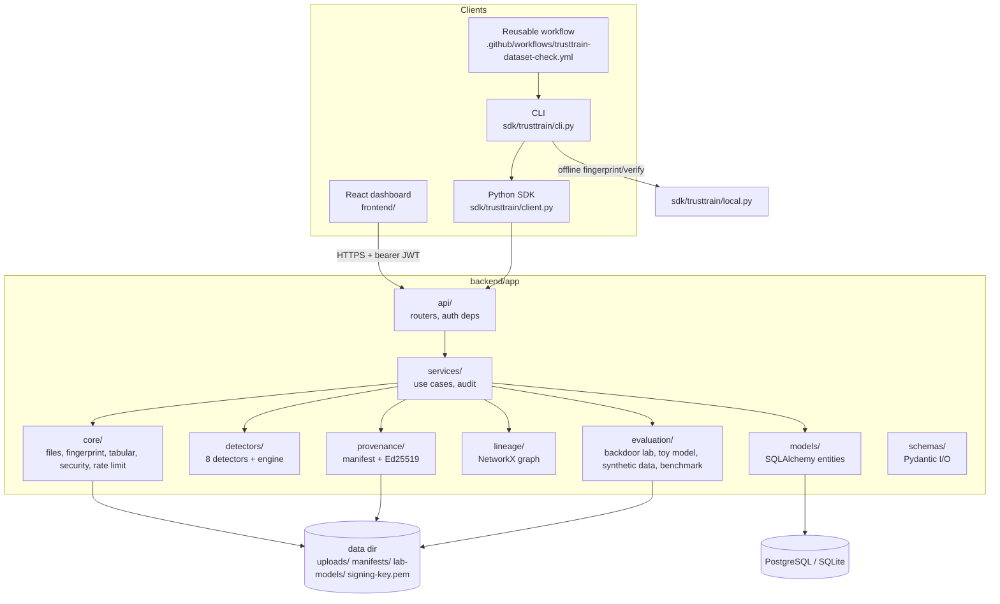
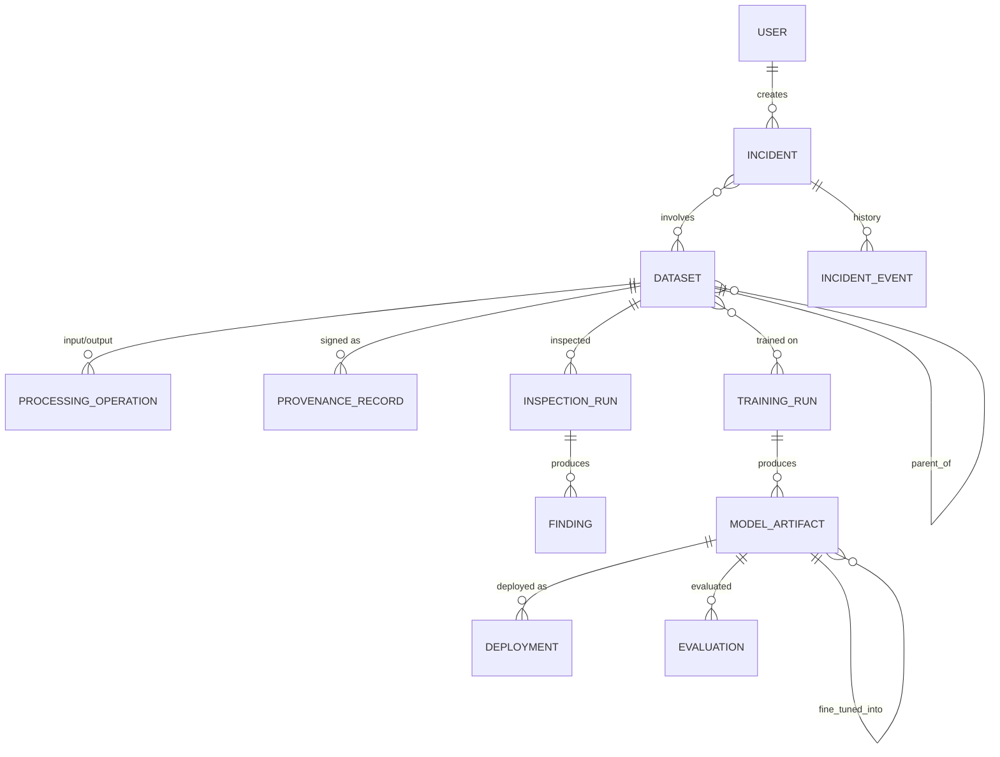

# Architecture

TrustTrain is a modular monolith: one FastAPI service with clearly separated domain packages, a relational database, a local artifact store and thin clients. That keeps deployment simple (two containers plus PostgreSQL) while the domain code stays independently testable.

## Components

| Package | Responsibility |
| --- | --- |
| `api/` | HTTP routing, request validation, role checks (`deps.py`: `Viewer`, `Analyst`, `Admin`) |
| `services/` | Use cases that combine domain modules and persistence; every state change writes an `AuditEvent` |
| `core/files.py` | Streaming uploads with size limit, server-generated names, archive rejection |
| `core/fingerprint.py` | Dataset DNA: file, chunk and row hashes, Merkle root, duplicates, manifest diff |
| `core/tabular.py` | Format detection and safe loading (CSV, JSON, JSONL, Parquet, TXT) with row and cell limits |
| `core/security.py` | scrypt password hashing, JWT issue and verify, role ordering |
| `core/ratelimit.py` | Sliding-window rate limiting per client IP (stricter on login) |
| `detectors/` | Poisoning detectors and risk aggregation |
| `provenance/` | Provenance manifest construction, canonical JSON, Ed25519 signing, trust evaluation |
| `lineage/graph.py` | Builds a NetworkX `DiGraph` from recorded relationships; downstream traversal |
| `evaluation/` | Backdoor Discovery Lab, deterministic PyTorch toy classifier, synthetic attack lab, benchmark |
| `models/entities.py` | SQLAlchemy 2 ORM entities |
| `alembic/` | Schema migrations (production schemas are only changed through migrations) |

## Data model

Tables: `users`, `datasets`, `processing_operations`, `provenance_records`, `inspection_runs`, `findings`, `training_runs`, `model_artifacts`, `deployments`, `evaluations`, `incidents`, `incident_events`, `audit_events`, plus association tables.

## Key flows

### Dataset import

1. `POST /api/datasets` streams the upload into a temp file inside `uploads/` (`mkstemp`), enforcing `TRUSTTRAIN_MAX_UPLOAD_BYTES` while streaming.
2. Magic bytes are checked; archives are rejected. The extension must be one of the supported formats.
3. The file is atomically renamed to `<uuid>.<ext>`. The client filename is kept only as metadata.
4. The file is parsed (validating format and limits) and fingerprinted. The manifest is written to `manifests/<dataset id>.json`.
5. A provenance manifest is built from the dataset record, the fingerprint and recorded processing operations, signed with Ed25519 and stored as a `ProvenanceRecord`.

### Integrity verification

`POST /verify` re-hashes the stored file and compares whole-file hash, chunk hashes and row fingerprints with the import manifest. Results: `verified`, or `modified` with changed chunk indices, counts and samples of added and removed rows, added or removed columns and dtype changes. `content_equivalent` reports whether the row Merkle root still matches (for example after a re-encode with identical rows). `POST /compare` does the same for an uploaded candidate copy without storing it, which is how you check a copy that lives elsewhere (for example the file a training job actually read).

### Provenance trust

`provenance/manifest.py::evaluate_record` marks a manifest **trusted only if** it was signed by the server's current key, the signature verifies over the canonical JSON, and the signed SHA-256 equals the current file hash. Anything else is returned as untrusted with explicit reasons. The dashboard shows untrusted manifests as untrusted, never as merely "unsigned".

### Lineage

`lineage/graph.py::build_graph` reads only recorded rows:

| Edge | Source |
| --- | --- |
| dataset → dataset (`derived_via:<operation>`) | `processing_operations` |
| dataset → dataset (`parent_of`) | `datasets.parent_id` when no operation was recorded |
| dataset → training run (`trained`) | training run input datasets |
| training run → model (`produced`) | `model_artifacts.training_run_id` |
| model → model (`fine_tuned_into`) | `model_artifacts.parent_model_id` |
| model → deployment (`deployed_as`) | `deployments.model_id` |

Downstream impact is `nx.descendants` from the dataset node, grouped by kind with the shortest path for each node. No relationship is ever inferred from names, timestamps or similarity.

### Incident response

Incidents follow an explicit state machine (`services/incidents.py::TRANSITIONS`). Associating a dataset computes impact from the lineage graph. Quarantine is a separate admin-only call that flags a dataset (`quarantined = true`) or sets a model's status to `quarantined`, and records an event. Release reverses the flag. It never deletes or alters files. Quarantined datasets cannot be approved.

## Design decisions

| Decision | Rationale |
| --- | --- |
| Modular monolith instead of microservices | One deployable, transactional consistency, and the brief asked for no unnecessary infrastructure |
| Synchronous inspection | Bounded by row and size limits; avoids a queue dependency. Large datasets are listed on the roadmap |
| TF-IDF/LSA default embeddings | Deterministic, offline, no model download; transformer embeddings are opt-in |
| NetworkX for lineage | Graphs are small (thousands of nodes) and rebuilt per request from authoritative tables, so there is no second source of truth |
| Ed25519 + canonical JSON | Small keys, fast, deterministic signatures, standard `cryptography` implementation |
| Bearer tokens in `sessionStorage`, no cookies | No ambient credentials, so CSRF does not apply. Tokens are cleared when the tab closes |
| `.npz` model weights | Lab models are loaded with `allow_pickle=False`; no pickle anywhere |
| SQLite in development and tests, PostgreSQL in production | Zero-setup local runs; the test suite also runs against PostgreSQL (`TRUSTTRAIN_TEST_DATABASE_URL`) |

## Frontend

`frontend/src` is a React 19 + TypeScript single-page app built with Vite and styled with Tailwind CSS 4 (dark-first).

| Path | Content |
| --- | --- |
| `services/api.ts` | Typed fetch client; attaches the bearer token and maps errors |
| `hooks/useApi.ts` | Loading, error and data state for API calls |
| `hooks/useAuth.tsx` | Login state and role checks |
| `pages/` | Overview, Dataset Inventory, Dataset Inspection, Security Findings, Model Evaluation, Supply Chain Graph, Training Runs, Incidents, Reports, Settings, Login |
| `components/LineageGraph.tsx` | Interactive SVG lineage graph: layered left-to-right layout, click a node to highlight everything downstream of it, flagged nodes outlined |
| `components/charts.tsx` | Lightweight SVG charts with no charting dependency |

All dashboard figures come from `/api/dashboard/summary` and the list endpoints. Nothing is hard-coded.
